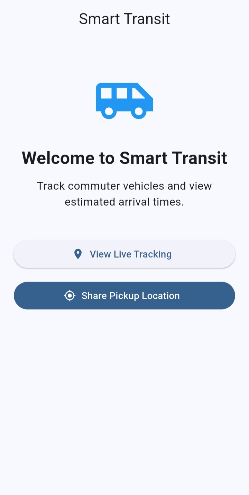
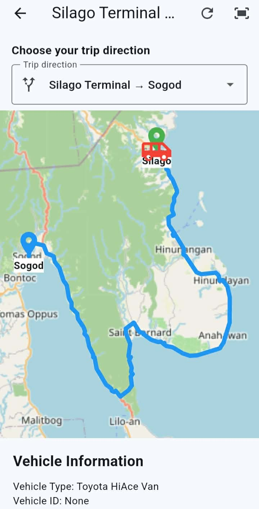
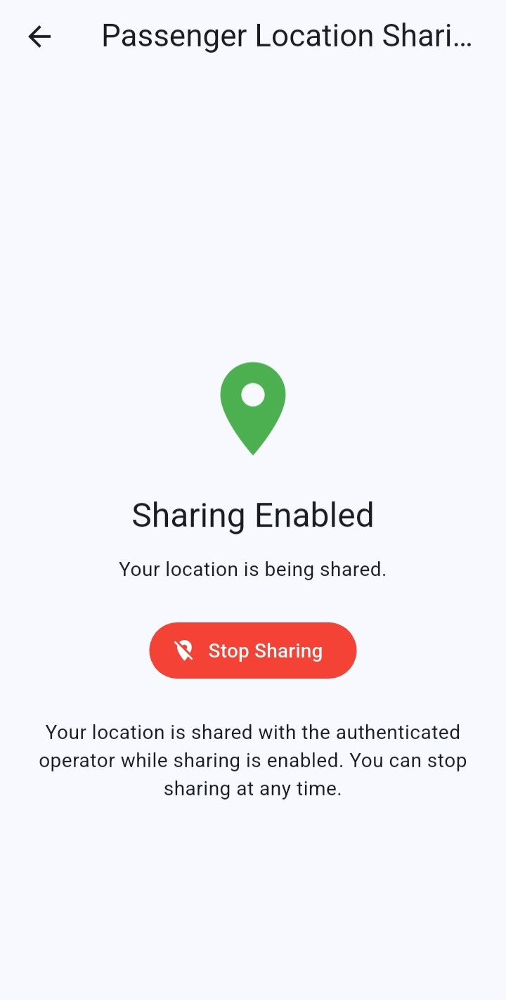
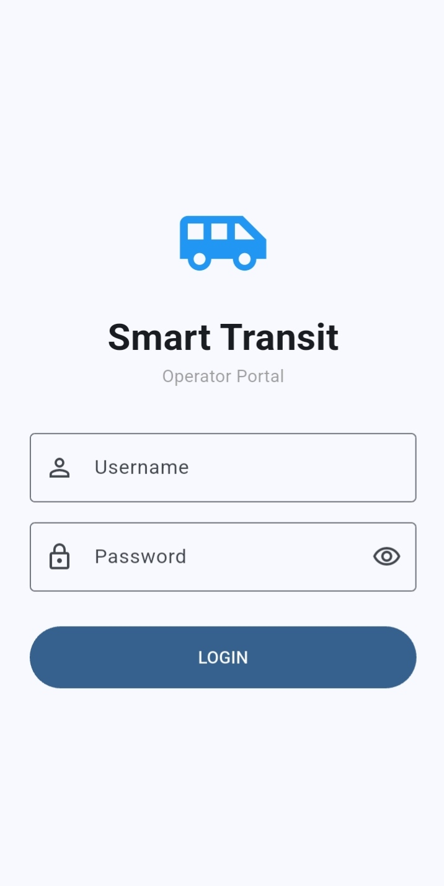
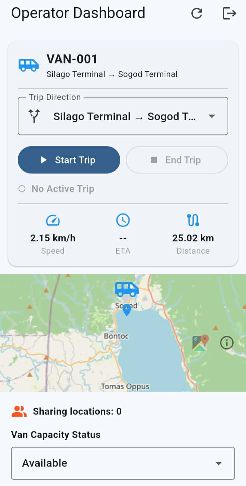
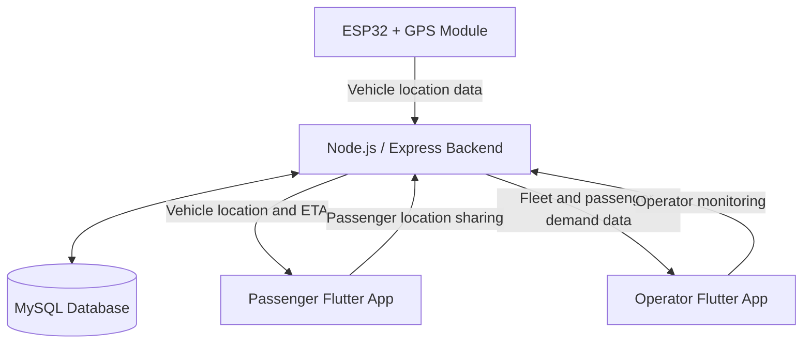

# Smart Transit System

### GPS-Based Commuter Vehicle Tracking and ETA Monitoring System

A mobile-based transportation monitoring system designed to improve commuter experience through real-time vehicle tracking, estimated time of arrival (ETA) monitoring, and passenger demand analysis.

The system consists of separate passenger and operator mobile applications, a backend server, a database, and GPS-enabled vehicle tracking hardware.

---

## Project Overview

The Smart Transit System aims to provide commuters with accessible vehicle tracking information while helping transport operators monitor vehicle locations and passenger demand.

Passengers can view vehicle locations and estimated arrival times, while operators can monitor fleet activity and passenger demand through a dedicated dashboard.

**Project Status:** Under Development

**Project Type:** Computer Engineering / Mobile Application / IoT

**Developers:** EJ Godpray Doquila and Team

---

## Technologies Used

### Mobile Development
- Flutter
- Dart

### Backend Development
- Node.js
- Express.js
- REST API

### Database
- MySQL

### Hardware and IoT
- ESP32
- GPS Module
- Cellular Communication Module

### Development Tools
- Visual Studio Code
- Git and GitHub
- Android Studio

---

## Key Features

### Passenger Application
- View available commuter vehicles.
- Monitor vehicle locations on a map.
- Check estimated time of arrival (ETA).
- Share passenger location when permitted.
- Receive vehicle capacity information.

### Operator Application
- Operator authentication.
- Monitor vehicle locations.
- View passenger locations who enabled location sharing.
- Monitor passenger demand.
- View demand summaries and hourly statistics.

### Backend System
- REST API for mobile applications.
- Vehicle location management.
- Trip management.
- Passenger session management.
- ETA calculation.
- Demand data collection and processing.

---

## Application Screenshots

### Passenger Application

**Passenger Home Screen**

**Vehicle Tracking Map**

**Passenger Location Sharing**

---

### Operator Application

**Operator Login**

**Operator Dashboard**

---

## System Architecture

The Smart Transit System uses a client-server architecture
to connect passengers, vehicle operators, and vehicle hardware.

--- 

## System Architecture

The Smart Transit System connects the passenger
application, operator application, vehicle hardware,
backend server, and MySQL database.

