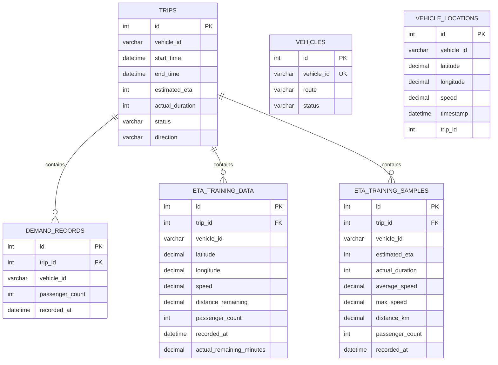

# Smart Transit Database Design

## Entity Relationship Diagram



## Foreign Key Constraints

- `demand_records.trip_id` references `trips.id`.
- `eta_training_data.trip_id` references `trips.id`.
- `eta_training_samples.trip_id` references `trips.id`.

Note: Other matching columns are not shown as
confirmed foreign-key relationships.
```
